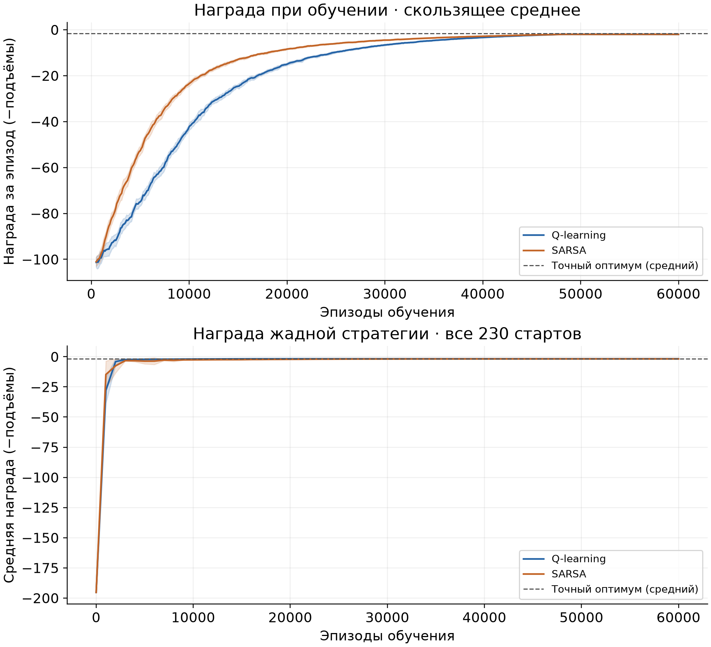
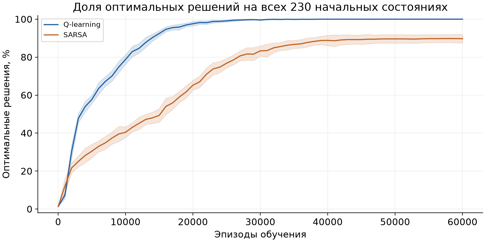
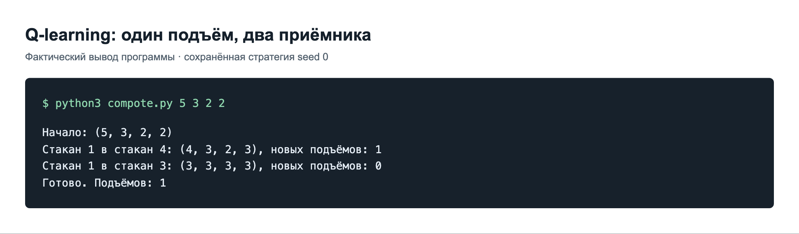
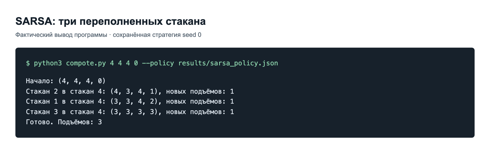
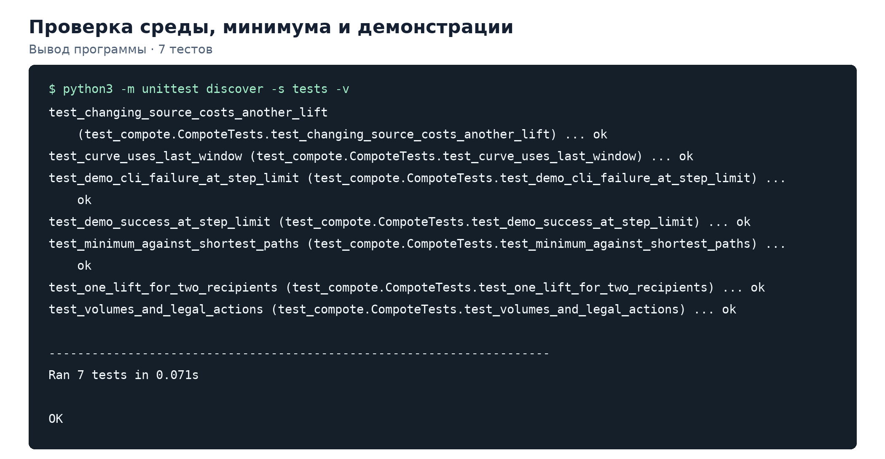

# Отчёт по практической работе

## Обучение агента переливанию компота

**Дисциплина:** «Интеллектуальные системы и технологии».

**Задание:** №4.

**Дата подготовки:** 18 ноября 2026 года.

[Краткий отчёт в PDF со скриншотами](REPORT_SHORT.pdf).

Цель работы — выровнять объёмы компота в четырёх стаканах с минимальным числом подъёмов. Реализованы Q-learning и SARSA из лекции по обучению с подкреплением [1]. В сохранённом эксперименте Q-learning получил оптимальное решение во всех итоговых проверках. SARSA получил в среднем 89,72% оптимальных решений. Оба метода достигли равенства объёмов во всех итоговых случаях.

## 1 Постановка задачи

Бабушка неровно разлила компот в четыре стакана. Агент должен перелить его так, чтобы объёмы стали одинаковыми. При этом нужно минимизировать число подъёмов: из одного поднятого стакана разрешено разлить компот в несколько других, и это считается одним подъёмом [3].

Работа включает ответы на вопросы до программирования, реализацию двух методов обучения, построение зависимости награды от числа эпизодов и сравнение методов.

Для численного эксперимента принята конечная дискретная модель: каждый стакан вмещает 6 условных единиц, общий объём равен 12, шаг переливания равен 1. Проверяются все допустимые неравномерные начальные распределения. Эти параметры задают модель опыта, а не дополнительные условия исходного задания.

## 2 Вопросы до программирования

Сначала необходимо определить модель, её параметры и критерий качества [2, с. 15]. Представление ситуации через состояние, действие и награду соответствует конечному марковскому процессу принятия решений [1, с. 5, 30–31].

1. **Какие объёмы и вместимость?** Четыре одинаковых стакана вместимостью 6 единиц, общий объём 12. Начальные объёмы — целые числа от 0 до 6 с суммой 12.
2. **Насколько точно выравнивать?** До точного равенства: по 3 единицы в каждом стакане. Дискретный шаг исключает погрешность сравнения вещественных чисел.
3. **Что считается подъёмом?** Подъём источника переливания. Если источник остаётся в руке, несколько последовательных переливаний считаются одним подъёмом.
4. **Нужно ли поднимать приёмник?** Нет. Приёмники стоят на столе, одновременно удерживается один источник. При смене источника предыдущий ставится на стол.
5. **Можно ли проливать или доливать извне?** Нет. Общий объём сохраняется, переполнение запрещено.
6. **Какие переливания разрешены?** Любая физически допустимая передача одной единицы между разными стаканами. Агенту не навязывается правило «только из избытка в недостаток».
7. **Что должен наблюдать агент?** Четыре объёма и номер стакана в руке. Без последнего признака стоимость действия зависит от скрытой истории.
8. **Что является действием?** Пара «источник, приёмник». Из 12 пар исключаются пустые источники и полные приёмники.
9. **Когда закончить эпизод?** При равных объёмах. Ограничение 200 переливаний — техническое отсечение, а не достижение цели.
10. **Как награда выражает цель?** `-1` за новый подъём и `0` за продолжение из того же источника. Сумма наград успешного эпизода равна минус числу подъёмов.
11. **Какие методы использовать?** Табличные Q-learning и SARSA с одинаковыми параметрами и ε-жадным выбором действий [1, с. 79–80].
12. **Как измерять качество?** Проверять успех, число подъёмов и совпадение с точным минимумом. Измерение качества следует общей лекции [2, с. 41, 161]; полный перебор стартов и повторения с разными seed составляют протокол этого эксперимента.

## 3 Модель среды и награда

Состояние имеет вид:

$$
s=(v_1,v_2,v_3,v_4,h),
$$

где каждый объём лежит в диапазоне от 0 до 6, сумма объёмов равна 12, а `h` — стакан в руке. В программе стаканы пронумерованы от 0 до 3, значение `h = -1` означает отсутствие стакана в руке.

Действие `a = (i, j)` переносит одну единицу из стакана `i` в стакан `j` и устанавливает `h = i`. Переход детерминирован. Следующее состояние и награда зависят только от текущего состояния и действия, как требует конечный MDP [1, с. 30–31].

Всего существует 231 допустимый вектор объёмов. С учётом пяти значений `h` получается 1155 сочетаний. Равномерному вектору соответствуют пять терминальных сочетаний. Начальный вектор выбирается равновероятно из остальных **230**, при `h = -1`.

Награда:

$$
r(s,(i,j))=-\mathbf{1}[i\ne h].
$$

При коэффициенте дисконтирования `γ = 1` доход завершённого эпизода равен:

$$
G_0=\sum_{t=0}^{T-1}r_{t+1}=-L,
$$

где `L` — число подъёмов. Максимизация дохода поэтому точно соответствует минимизации подъёмов. Отдельного штрафа за каждое переливание или бонуса за уменьшение разброса объёмов нет: награда выражает критерий, а не заранее хорошие ходы [1, с. 33]. Эпизодическая задача и смысл дисконтирования рассмотрены в [1, с. 34–35].

Бесконечно выполнять бесплатные действия нельзя: без смены источника он может отдать не более 6 единиц. Любой цикл требует нового подъёма и имеет отрицательную суммарную награду.

### Один подъём и два переливания

В этой таблице стаканы пронумерованы с 1.

| Действие | Объёмы после действия | Новых подъёмов |
| --- | --- | --- |
| Начальное состояние | (5, 3, 2, 2) | 0 |
| Из стакана 1 в стакан 3 | (4, 3, 3, 2) | 1 |
| Из стакана 1 в стакан 4 | (3, 3, 3, 3) | 0 |

Итого: два переливания, один подъём и награда `-1`. Номер удерживаемого стакана позволяет правильно учитывать именно эту ситуацию.

## 4 Точный минимум подъёмов

Пусть средний объём равен $\bar v$, а `k` стаканов изначально заполнены выше среднего. Каждый из них должен отдать часть жидкости, а это требует подъёма самого стакана. Следовательно, `L ≥ k`.

Общий избыток равен общему недостатку. Можно последовательно поднять каждый переполненный стакан и раздать весь его избыток недолитым стаканам, не меняя источник до окончания раздачи. Приёмники заполняются не выше среднего, поэтому вместимость не нарушается. Это даёт `L ≤ k`.

Таким образом, при принятых физических правилах:

$$
L^*=\#\{i:v_i(0)>\bar v\}.
$$

Это самостоятельное доказательство для данной задачи. В тестах формула независимо проверяется поиском кратчайших путей с ценами 0 и 1 — алгоритмом **0-1 BFS**. Его результат не используется для обучения.

| Точный минимум | Начальных распределений |
| --- | --- |
| 1 подъём | 76 |
| 2 подъёма | 150 |
| 3 подъёма | 4 |
| Всего | 230 |

Средний точный минимум на равномерном наборе стартов:

$$
\frac{76+2\cdot150+3\cdot4}{230}=\frac{388}{230}\approx1.6869565.
$$

Для уже равных объёмов минимум равен нулю; такие старты в обучающий набор не включены, но демонстрация агента обрабатывает их без переливаний.

## 5 Методы обучения

Состояния и действия имеют небольшой конечный набор, поэтому используется таблица ценности действий `q[state][action]` [1, с. 49]. При первом посещении оценки допустимых действий инициализируются нулями.

### Q-learning

$$
Q(s,a)\leftarrow Q(s,a)+\alpha\left[r+\gamma\max_{b\in A(s')}Q(s',b)-Q(s,a)\right].
$$

Q-learning — метод off-policy: обновление использует лучшее следующее действие, даже если поведенческая стратегия выберет другое. Формула и псевдокод приведены в [1, с. 80, напечатанный номер слайда 95]. Максимум берётся только по допустимым действиям.

### SARSA

$$
Q(s,a)\leftarrow Q(s,a)+\alpha\left[r+\gamma Q(s',a')-Q(s,a)\right].
$$

SARSA — метод on-policy. Следующее действие `a′` выбирается по текущей ε-жадной стратегии, его ценность входит в цель обновления, и именно оно затем выполняется. Формула и псевдокод приведены в [1, с. 79, напечатанный номер слайда 94].

### Исследование и конец эпизода

С вероятностью `ε` выбирается случайное допустимое действие, иначе — действие с максимальным `Q`. При равенстве оценок во время обучения выбор случайный. Жадные и исследовательские действия обсуждаются в [1, с. 14], ε-мягкие стратегии — в [1, с. 69].

В терминальном состоянии будущая ценность равна нулю. При достижении равенства цель обновления содержит только последнюю награду. Если достигнут технический лимит 200 шагов, состояние не объявляется терминальным: последнее обновление сохраняет оценку будущего дохода. Для SARSA при этом также выбирается следующее действие для оценки.

## 6 Эксперимент

| Параметр | Значение |
| --- | --- |
| Эпизодов на один запуск | 60 000 |
| Запусков на метод | 20, seed от 0 до 19 |
| Начальные оценки Q | 0 |
| Шаг обучения α | 0,2, постоянный |
| Дисконтирование γ | 1 |
| Исследование ε | От 1 до 0,05 линейно за первые 80% эпизодов |
| Последние 20% эпизодов | ε = 0,05 |
| Техническое отсечение | 200 переливаний |
| Контрольная проверка | До обучения и каждые 1000 эпизодов |
| Сглаживание обучающей награды | Окно 500 эпизодов, точка графика каждые 100 эпизодов |

Каждый метод получил **1 200 000 эпизодов**. Для соответствующего seed методы используют одну и ту же последовательность стартовых состояний. Действия различаются, поскольку стратегии обучаются по-разному. Порядок запуска методов чередуется между seed.

При проверке исследование отключено: `ε = 0`, а равенство оценок разрешается фиксированным порядком пар. Каждая готовая стратегия проверяется на всех 230 стартах. Итог для каждого метода включает `20 × 230 = 4600` траекторий.

Это полная проверка выбранной конечной области состояний, которая также используется при обучении. Отдельного вывода об обобщении на новые объёмы или другую вместимость из неё не следует.

### Метрики

- **Успех:** доля стартов, достигших равенства за 200 переливаний.
- **Оптимальность:** доля всех стартов, где цель достигнута с точным минимумом подъёмов. Неудача не считается оптимальным решением.
- **Число подъёмов и награда:** стоимость готовой стратегии.
- **Число переливаний:** дополнительный показатель, который не входит в целевую награду.
- **Взаимодействия со средой:** число обучающих переходов.

Для отсечённого фрагмента журнал содержит награду только до отсечения. Поэтому награду такого фрагмента следует оценивать вместе с признаком успеха. Доля отсечений на обучении составила 3,54% у Q-learning и 1,86% у SARSA. В итоговых жадных проверках отсечений нет.

## 7 Кривые обучения



Верхний график показывает награду при обучении со сглаживанием за 500 эпизодов. Нижний — награду готовой жадной стратегии на полном наборе стартов. По горизонтали в обоих случаях отложено число обучающих эпизодов.

Линии показывают среднее по 20 seed, полоса — одно стандартное отклонение между запусками, а не доверительный интервал. Пунктир соответствует точному среднему оптимуму `-388/230`. На обучении старты выбираются случайно, поэтому их скользящая средняя не обязана точно совпадать со средним по полному набору.



Второй рисунок показывает долю стартов, где цель достигнута с точным минимумом подъёмов. Он позволяет увидеть различие готовых стратегий, которое мало заметно на полном масштабе графика награды.

## 8 Результаты и сравнение

| Метрика после 60 000 эпизодов | Q-learning | SARSA |
| --- | --- | --- |
| Успешные решения | 100% | 100% |
| Оптимальные решения | 100% | 89,72% ± 2,25 п. п. |
| Оптимальных траекторий | 4600 из 4600 | 4127 из 4600 |
| Среднее число подъёмов | 1,68696 | 1,79413 ± 0,02575 |
| Средняя награда | -1,68696 | -1,79413 |
| Среднее число переливаний | 6,10870 | 3,26848 |
| Устойчивый порог 95% оптимумов | 17 000 эпизодов | Не достигнут к концу опыта |
| Взаимодействий на обучении одного запуска | 1 716 291 | 1 113 498 |

Знак `±` означает стандартное отклонение по 20 seed. Порог 95% определяется как первый контрольный момент, после которого все оставшиеся проверки остаются не ниже 95%; в таблице указана медиана. Q-learning достиг такого порога в 20 из 20 запусков, SARSA — в 0 из 20.

**По основному критерию задания лучше оказался Q-learning:** он совпал с точным минимумом во всех итоговых траекториях. SARSA использовал в среднем на 0,10717 подъёма больше, примерно на 6,35% выше точного среднего минимума.

Различие согласуется с устройством алгоритмов [1, с. 79–81]. Q-learning оценивает лучший следующий ход. SARSA учитывает действия ε-жадной стратегии, поэтому при конечном `ε = 0,05` продолжает учитывать будущие исследовательские ошибки. Более короткая по переливаниям траектория может уменьшить число возможностей для такой ошибки, даже если иногда требует дополнительного подъёма. Это объяснение согласуется с наблюдениями; его нельзя считать отдельной экспериментальной проверкой влияния ε.

За одинаковые 60 000 эпизодов SARSA сделал примерно на 35% меньше переливаний во время обучения. Его средняя награда за весь период обучения выше: `-13,7514` против `-19,4518` у Q-learning. На последних 1000 эпизодах значения близки: `-2,0105` и `-2,0058` соответственно. Поэтому качество поведения во время исследования и оптимальность готовой жадной стратегии дают разные стороны сравнения. Аналогичное различие on-policy и off-policy поведения показано в лекционном примере с обрывом [1, с. 81].

Q-learning в среднем делает больше переливаний, поскольку награда штрафует только подъёмы. Лишнее переливание из уже поднятого стакана может не увеличить целевую стоимость. Если требуется также минимизировать число переливаний, необходимо явно добавить вторичный критерий.

Постоянный шаг обучения, положительное конечное ε и конечный бюджет не дают основания утверждать теоретическую асимптотическую сходимость этого эксперимента. Проценты качества относятся к указанной сетке объёмов и параметрам.

## 9 Примеры готовых стратегий

| Начальные объёмы | Точный минимум | Q-learning, seed 0 | SARSA, seed 0 |
| --- | --- | --- | --- |
| (5, 3, 2, 2) | 1 | 1 | 1 |
| (6, 6, 0, 0) | 2 | 2 | 2 |
| (4, 4, 4, 0) | 3 | 3 | 3 |
| (0, 4, 6, 2) | 2 | 2 | 3 |

В первом примере Q-learning разливает из первого стакана в четвёртый и третий, сохраняя источник в руке. Во всех стаканах получается по 3 единицы за один подъём.

На старте `(0, 4, 6, 2)` только второй и третий стаканы содержат больше трёх единиц. Каждый должен отдать часть компота, поэтому минимум равен двум подъёмам. Q-learning поднимает каждый из них один раз. SARSA поднимает третий стакан, переключается на второй и затем снова поднимает третий. На этом старте Q-learning выполняет девять переливаний, а SARSA — четыре. Целевая награда учитывает число подъёмов.

Эти две команды показывают действия сохранённых стратегий на одном старте.

```sh
.venv/bin/python compote.py 0 4 6 2
.venv/bin/python compote.py 0 4 6 2 --policy results/sarsa_policy.json
```

## 10 Реализация и проверка

Код разделён на три небольших скрипта:

- `compote.py` содержит физику переливания, выбор действий и оба алгоритма. Состояния и действия записываются обычными кортежами, оценки — словарями.
- `train.py` запускает повторения, сохраняет журналы и итоговые метрики.
- `plot_results.py` строит графики по CSV без повторного обучения.

Тесты проверяют:

1. Один подъём при разливе из одного источника в двух разных получателей.
2. Дополнительный подъём при смене источника.
3. Сохранение объёма и вместимости для всех 10 860 допустимых переходов, запрет недопустимого переливания и отсутствие действий в терминальном состоянии.
4. Совпадение доказанной формулы минимума с независимым 0-1 BFS на всех 230 стартах.
5. Расчёт скользящего среднего по последнему окну наград.
6. Успешное завершение демонстрации, когда объёмы выравниваются на последнем допустимом переливании.
7. Код завершения `1`, если стратегия не достигла цели за 200 переливаний.

```sh
.venv/bin/python -m unittest discover -s tests -v
```

### Скриншоты вывода программы

На изображениях показан фактический вывод сохранённых стратегий и тестов. Рядом с каждым изображением доступен исходный текстовый журнал stdout/stderr.

**Q-learning: два переливания из одного поднятого стакана.** Объёмы `(5, 3, 2, 2)` выровнены за один подъём. [Текстовый вывод](results/screenshots/q_learning.txt).



**SARSA: три стакана выше среднего.** Объёмы `(4, 4, 4, 0)` выровнены за три подъёма, что совпадает с точным минимумом для этого старта. [Текстовый вывод](results/screenshots/sarsa.txt).



**Проверки среды, эталона и демонстрации.** Все семь тестов завершились успешно, включая независимый поиск точного минимума для всех 230 стартов. [Текстовый вывод](results/screenshots/tests.txt).



### Сохранённые файлы

| Файл | Содержимое |
| --- | --- |
| `results/summary.json` | Параметры, итоговые метрики и затраты обучения |
| `results/evaluation.csv` | Контрольные метрики для каждого метода и seed |
| `results/learning.csv` | Скользящая средняя награды для каждого seed |
| `results/training.csv.gz` | Все 2 400 000 обучающих эпизодов: награда, шаги и успех |
| `results/q_learning_policy.json` | Действия готового Q-learning первого запуска |
| `results/sarsa_policy.json` | Действия готового SARSA первого запуска |
| `results/learning_curves.png` | Кривые награды |
| `results/optimal_rate.png` | Доля оптимальных решений |
| `results/screenshots/` | Изображения вывода программы и исходные текстовые журналы |

CSV используют запятую как разделитель и точку как десятичный знак. Стратегии сохранены в обычном JSON, без двоичных объектов Python. Инструкция установки и команды воспроизведения находятся в [README.md](README.md).

## 11 Выводы

1. Для правильного подсчёта подъёмов состояние должно содержать номер стакана в руке. Тогда разлив в несколько приёмников из одного источника оплачивается одним подъёмом.
2. Оба метода научились достигать равенства объёмов: итоговый успех составил 100% на всех 230 стартах в каждом из 20 запусков.
3. По главному критерию задания выбран **Q-learning**. Он получил точный минимум во всех 4600 итоговых траекториях, со средним числом подъёмов 1,68696. У SARSA оптимальны 89,72% траекторий, среднее число подъёмов — 1,79413.
4. За одинаковое число эпизодов SARSA сделал примерно на 35% меньше переливаний во время обучения. Готовая стратегия SARSA также делает меньше переливаний в среднем. По главному критерию задания, минимуму подъёмов, лидирует Q-learning.
5. Результаты относятся к выбранной дискретной модели. Если требуется одновременно сокращать число переливаний, этот критерий нужно добавить в постановку; текущая награда учитывает только подъёмы.

## 12 Основания из лекций

| Решение в работе | Основание |
| --- | --- |
| Модель, параметры и критерий | [2], с. 15 |
| Состояние, действие, стратегия, ценность и конечный MDP | [1], с. 5, 30–31, 40–41 |
| Награда по цели и сумма наград | [1], с. 33–35 |
| Табличные оценки для небольшой задачи | [1], с. 49 |
| Исследовательские действия и ε-мягкая стратегия | [1], с. 14, 69 |
| Пошаговые обновления и Q-learning с SARSA | [1], с. 74, 79–80 |
| Различие поведения при исследовании и готовой стратегии | [1], с. 81 |
| Численные показатели полезности и измерение качества | [2], с. 41, 161 |

Дискретизация объёма, признак удерживаемого стакана, техническое отсечение и доказательство минимума являются формализацией конкретной задачи. Они не приписываются лекциям.

### Источники

1. **Судаков В. А. Обучение с подкреплением. 2022.** Файл `ИСиТ RL small.pdf`, 81 страница. Использованы страницы 5, 14, 30–35, 40–41, 49, 69, 74, 79–81. На страницах PDF 79 и 80 расположены слайды с напечатанными номерами 94 и 95.
2. **Судаков В. А. Интеллектуальные системы и технологии.** Файл `ИСиТ.pdf`, 162 страницы. Использованы страницы 15, 41 и 161.
3. **Задание №4.** Файл `ИСиТ пр.pptx`, слайд 1: выравнивание объёмов, минимум подъёмов, вопросы до программирования, два метода, кривые обучения и сравнение.

В ссылках указаны номера страниц PDF, считая первую за 1. Оригинальные лекции и задание находятся в папке `Учеба/ИСИТ` на рабочем столе.
